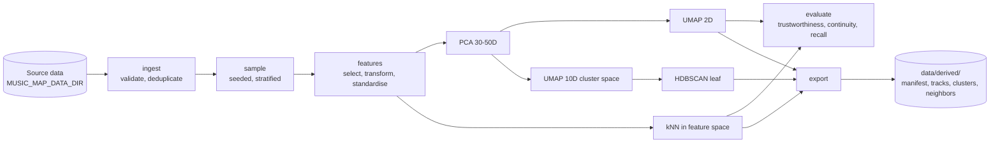
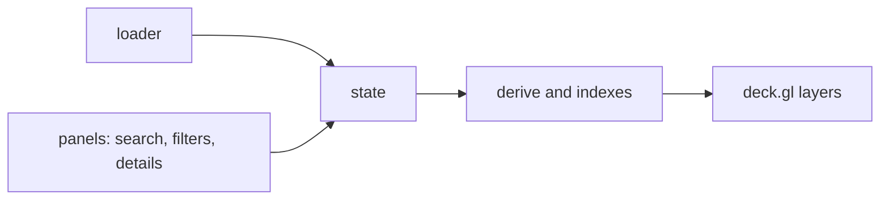

# Architecture

Music Atlas is an interactive 2D map of music tracks. Each track is a point; position comes from projecting high-dimensional audio features. Clusters and nearest neighbours are computed offline; the browser only renders and filters.

## Stack

| Layer | Choice | Notes |
|---|---|---|
| Pipeline | Python 3.12, `uv` | pandas, NumPy, PyArrow, scikit-learn (PCA, MDS, t-SNE, `HDBSCAN`, kNN, `trustworthiness`), umap-learn |
| Pipeline tests/lint | pytest, ruff | configured in `pipeline/pyproject.toml` |
| Frontend | React, TypeScript, Vite | npm, Node 24 |
| Map rendering | deck.gl (`OrthographicView`, `ScatterplotLayer`, `TextLayer`) | fallback: Canvas 2D + d3-zoom, decided by a spike measuring frame rate at 10k points |
| Frontend tests/lint | Vitest, ESLint, `tsc --noEmit` | |
| Backend | none | static export; no vector database |
| Export format | JSON (gzip) first | to be compared with a binary format by measured size and load time |
| First dataset | MTG-Jamendo (metadata TSV + Essentia/AcousticBrainz features) | licences differ per file type; raw data is never committed |

Python is pinned to 3.12 because numba (a UMAP dependency) support for newer interpreters was not verified. Known pitfall: Python 3.12 reads editable-install `.pth` files in the locale encoding, so a repository path containing non-ASCII characters can hide `src/` from `sys.path`. `pytest` is configured with `pythonpath = ["src"]` to avoid this; scripts should be run from an ASCII path or with Python 3.13.

## Data flow (offline pipeline)



Each stage writes an artefact together with a hash of its parameters, so variants can be compared and runs resumed.

## Runs: choosing what to load

A run is a versioned TOML file in `pipeline/runs/` (`pilot.toml`): dataset, sample size and seed, feature set, projection, clustering, neighbours and quality settings. `npm run atlas` executes it through `pipeline/scripts/run.py pilot` and writes `data/derived/<run>/`. Unknown keys are errors. `.env` holds only machine-specific values (the data directory); experiment choices belong in the run file so that every atlas is reproducible from its commit and its manifest. The manifest records the parameters, library versions, distance metric and quality scores.

## Runtime flow (browser)



State holds view, selection, filters and colour mode. Derived values (visibility mask, colours, search index, nearest point) are computed from state and the loaded atlas. Interactions change state only.

## Data contract

Field names are the wire format. `schema_version` is bumped on any change. The contract is mirrored in `frontend/src/data/types.ts`.

**Manifest**

```json
{"schema_version": "0.5", "dataset_version": "jamendo-10000-seed42",
 "projection_id": "acoustic-v1-pca40-umap15-hdbscan40leaf", "feature_set_id": "acoustic-v1",
 "track_count": 10000, "seed": 42, "run": "pilot",
 "distance_metric": "euclidean on clipped, standardised features",
 "parameters": {"sample_size": 10000, "umap_neighbors": 15},
 "library_versions": {"umap-learn": "0.5.12"},
 "quality": {"umap": {"10": {"trustworthiness": 0.862, "continuity": 0.930, "recall": 0.129}}},
 "summary": {"requested": 10000, "dropped_without_features": 0, "clusters": 41, "clustered_share": 0.389,
             "layout": "umap", "alternate_layout": "hierarchical"}}
```

**Track**

```json
{"id": "jamendo:12345", "title": "Example Track", "artist": "Example Artist",
 "artist_id": "artist_375104", "x": -12.48, "y": 6.73, "cluster_id": 17, "home_cluster_id": 17,
 "alt_x": 3.1, "alt_y": -2.4,
 "genres": ["rock"], "instruments": ["guitar"], "moods": ["energetic"],
 "features": {"bpm": 114.0, "energy": 0.82}, "source_url": null}
```

`cluster_id` is a single id, or `null` for noise. `artist_id` (schema 0.3 and later) is optional; without it the artist controls are not shown. `home_cluster_id` (schema 0.4 and later) is the track's own cluster or, for noise, the cluster it is closest to in feature space; the interface tints unclustered tracks with it. `alt_x` and `alt_y` (schema 0.5 and later) are the position in a second layout, present on every track and every cluster or on none; the manifest summary names the two layouts (`layout` behind `x` and `y`, `alternate_layout` behind `alt_x` and `alt_y`), and the interface offers a Layout switch only when they exist. Optional fields depend on the dataset.

**Cluster**

```json
{"id": 17, "label": "Psychedelic / Rock", "size": 325, "x": -10.1, "y": 8.4, "top_tags": ["rock", "guitar"]}
```

**Neighbors**

```json
{"track_id": "jamendo:12345", "neighbors": [{"id": "jamendo:23456", "distance": 0.41}]}
```

`distance` is measured in the standardised feature space, not on the map. The metric name and feature-set version are recorded in the export metadata.

**Feature graph** (`features.json.gz`, optional; drives the Features tab)

```json
{"feature_set_id": "acoustic-v1", "genre_quantiles": [10, 25, 50, 75, 90],
 "min_abs_correlation": 0.7, "track_count": 55607,
 "features": [{"id": "rhythm.bpm", "label": "bpm", "family": "rhythm", "x": 0.31, "y": -0.8,
   "power": 0.04, "stats": {"min": 59.8, "p25": 103.8, "median": 120.1, "p75": 139.4,
   "max": 191.4, "mean": 121.0, "std": 25.1, "skew": 0.29},
   "histogram": {"edges": [73.9, 76.5], "counts": [12], "below": 279, "above": 279},
   "genre_profile": {"rock": [90.1, 105.0, 120.2, 135.1, 150.3]},
   "genre_histogram": {"rock": [0.01, 0.03]},
   "tag_profile": [{"tag": "trance", "category": "genre", "mean_z": 0.441, "n": 1528}]}],
 "edges": [{"source": "rhythm.bpm", "target": "rhythm.bpm_histogram_first_peak_bpm.mean", "r": 0.98}]}
```

Nodes are features. `x`, `y` come from MDS of `1 - |r|` (then spread so nodes do not overlap), so tags never influence the layout. `power` is the share of the feature's variance explained by single-genre labels (eta squared, 0 to 1). `genre_profile` holds the quantiles listed in `genre_quantiles` of the raw feature value per genre. `genre_histogram` is the share of each genre's tracks per bin of `histogram` (same edges). `tag_profile` lists the tags with the highest and lowest mean standardised value of the feature (tags with at least 300 tracks; `mean_z` is in standard deviations).

**Feature sample** (`feature_sample.json.gz`, optional; drives the Compare tab)

```json
{"feature_set_id": "acoustic-v1", "features": ["rhythm.bpm", "tonal.key_strength"],
 "genres": ["rock", null], "values": [[120.1, 0.71], [98.4, 0.55]]}
```

A seeded random sample of 2500 tracks with raw feature values (4 significant digits) in the order of `features`; `genres` is the track's first genre among the 12 most frequent single-genre labels, or null.

Written by `pipeline/scripts/build_feature_graph.py`; mirrored by `frontend/src/data/featureGraph.ts`.

## Open questions

- Which acoustic features the chosen dataset actually provides (decides the feature set).
- How to represent tracks with incomplete features.
- Search index format: small JSON, in-browser structure, or a separate file.
- Whether source identifiers are stable across dataset updates.
- Physical export format and chunking.
