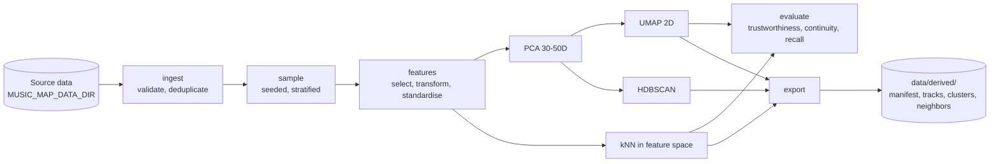
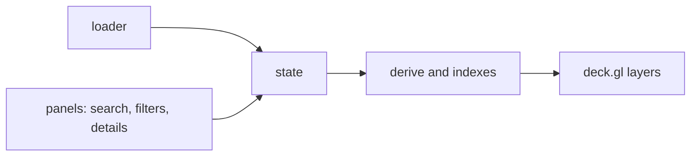

# Architecture

Music Atlas is an interactive 2D map of music tracks. Each track is a point; position comes from projecting high-dimensional audio features. Clusters and nearest neighbours are computed offline; the browser only renders and filters.

## Stack

| Layer | Choice | Notes |
|---|---|---|
| Pipeline | Python 3.12, `uv` | pandas, NumPy, PyArrow, scikit-learn (PCA, MDS, t-SNE, `HDBSCAN`, kNN, `trustworthiness`), umap-learn |
| Pipeline tests/lint | pytest, ruff | configured in `pipeline/pyproject.toml` |
| Frontend | React, TypeScript, Vite | npm, Node 24 |
| Map rendering | deck.gl (`OrthographicView`, `ScatterplotLayer`, `TextLayer`) | fallback: Canvas 2D + d3-zoom, decided by a spike measuring frame rate at 10k points |
| Frontend tests/lint | Vitest, ESLint, `tsc --noEmit` | |
| Backend | none | static export; no vector database |
| Export format | JSON (gzip) first | to be compared with a binary format by measured size and load time |
| First dataset | MTG-Jamendo (metadata TSV + Essentia/AcousticBrainz features) | licences differ per file type; raw data is never committed |

Python is pinned to 3.12 because numba (a UMAP dependency) support for newer interpreters was not verified. Known pitfall: Python 3.12 reads editable-install `.pth` files in the locale encoding, so a repository path containing non-ASCII characters can hide `src/` from `sys.path`. `pytest` is configured with `pythonpath = ["src"]` to avoid this; scripts should be run from an ASCII path or with Python 3.13.

## Data flow (offline pipeline)



Each stage writes an artefact together with a hash of its parameters, so variants can be compared and runs resumed.

## Runtime flow (browser)



State holds view, selection, filters and colour mode. Derived values (visibility mask, colours, search index, nearest point) are computed from state and the loaded atlas. Interactions change state only.

## Data contract

Field names are the wire format. `schema_version` is bumped on any change. The contract is mirrored in `frontend/src/data/types.ts`.

**Manifest**

```json
{"schema_version": "0.1", "dataset_version": "pilot-001", "projection_id": "acoustic-v1-umap40",
 "feature_set_id": "acoustic-v1", "track_count": 10000, "seed": 42}
```

**Track**

```json
{"id": "jamendo:12345", "title": "Example Track", "artist": "Example Artist",
 "x": -12.48, "y": 6.73, "cluster_id": 17,
 "genres": ["rock"], "instruments": ["guitar"], "moods": ["energetic"],
 "features": {"bpm": 114.0, "energy": 0.82}, "source_url": null}
```

`cluster_id` is a single id, or `null` for noise. Optional fields depend on the dataset.

**Cluster**

```json
{"id": 17, "label": "Psychedelic / Rock", "size": 325, "x": -10.1, "y": 8.4, "top_tags": ["rock", "guitar"]}
```

**Neighbors**

```json
{"track_id": "jamendo:12345", "neighbors": [{"id": "jamendo:23456", "distance": 0.41}]}
```

`distance` is measured in the standardised feature space, not on the map. The metric name and feature-set version are recorded in the export metadata.

## Open questions

- Which acoustic features the chosen dataset actually provides (decides the feature set).
- How to represent tracks with incomplete features.
- Search index format: small JSON, in-browser structure, or a separate file.
- Whether source identifiers are stable across dataset updates.
- Physical export format and chunking.
